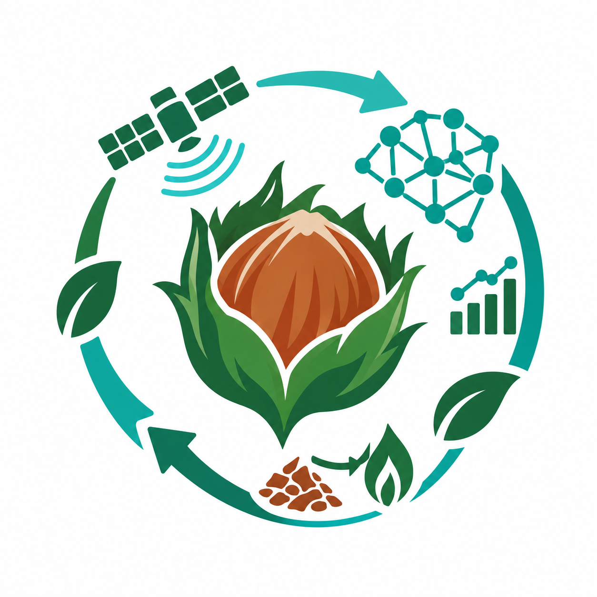

# 🌰 Gapçuk AI: Fındık Zürufu Biyokütle Döngüselliği & Külleme Erken Uyarı Platformu

<p align="center">
  
</p>

<p align="center">
  <strong>Ordu / Ünye Pilot Havzası • Biyokütle Atık Yönetimi, OSRM Dinamik Rota Optimizasyonu ve AI Külleme Tahmini</strong>
</p>

<p align="center">
  <a href="https://climathon-gapcuk-ai.vercel.app"></a>
  <a href="https://climathon-gapcuk-ai.vercel.app/simulasyon.html"></a>
  <a href="#"></a>
  <a href="#"></a>
  <a href="#"></a>
  <a href="#"></a>
  <a href="#"></a>
</p>

---

## 📌 Problem ve Saha Gerçeği (Ordu / Ünye)
Türkiye, dünya fındık üretiminin **%70'ini** karşılamaktadır. Her yıl hasat sonrasında açığa çıkan yaklaşık **175.000 ton fındık zürufu (yöresel adıyla *gapçuk*)**, plansız yönetim ve kırsal lojistik eksikliği nedeniyle iki büyük çevre ve tarım krizine yol açmaktadır:

1. **Çiğ Olarak Fındık Ocaklarına Saçılması (%80-90):** Üreticiler iyi niyetle gübre olsun diye çiğ gapçuğu bahçeye sermektedir. Bu durum hem topraktaki azotu tüketmekte (*C:N 50:1 Azot Hırsızlığı*) hem de fındıkta %30'a varan rekolte kaybına yol açan **Külleme Hastalığı (*Erysiphe corylacea*)** mantarı için kışlama yatağı oluşturmaktadır.
2. **Açıkta Yakma ve Yol Kapanmaları (%5-10):** Dar köy yollarını kapatan dev gapçuk yığınları ateşe verilmekte; her 1 tonu için **1.45 ton CO₂e sera gazı**, yoğun PM2.5 partikül maddesi salınmakta ve yangın/menfez tıkanması riskleri doğmaktadır.
3. **Pazar Tıkanıklığı (Market Failure):** Bölgedeki biyokütle enerji santralleri (Çarşamba BES - 27 MWe) sınırsız hammadde talep etmekte ve tonuna 2.000 TL + KDV ödemektedir. Ancak santral araç göndermemekte (*santral teslim*), küçük üretici ise 40 çuval için tek başına 50 km nakliye tutamamaktadır. **Gapçuk AI, bu lojistik ve koordinasyon açığını kapatan köprüdür.**

---

## 🚀 Çözüm: Gapçuk AI Üçlü Modüler Platform

Gapçuk AI; fındık zürufunu bir çevre felaketi ve hastalık yuvası olmaktan çıkarıp, **biyokütle enerjisi ve yüksek değerli biyo-komposta** dönüştüren uçtan uca karar destek sistemidir.

### 1. 🗺️ GapçukRoute™ (Gerçek Yol Takibi & 2 Kademeli Hibrit Lojistik)
* **OSRM (*Open Source Routing Machine*) Entegrasyonu:** Kuş uçuşu düz çizgiler yerine; Ünye Ziraat Odası'ndan başlayarak Tekkiraz, Yazkonağı, Pelitliyatak ve Erenyurt dağ köylerinin virajlı asfalt yollarını ve D010 arterini birebir takip eden gerçek rotalama motoru.
* **Aciliyet Ağırlıklı TSP Optimizasyonu:** Çöp/züruf nakliye filosu için duraklar aciliyet ve coğrafi mesafeye göre (`#1`, `#2`, `#3`...) dizilir; plansız turlamaya kıyasla **%34 yakıt tasarrufu** sağlanır.
* **2 Kademeli Hibrit Lojistik (Hub & Spoke):** Dik dağ yollarında züruf **10-12 tonluk kırsal damperli ring araçlarıyla** toplanır. Ünye Ziraat Odası merkezinde konsolide edilerek Samsun Çarşamba BES kantar teslimine **tek bir 25 tonluk tırla** sevk edilir.
* **Hedef Biyokütle Alıcısı:** Oltan & Köleoğlu Çarşamba BES (27 MWe) kantar teslimi (42 km).

---

### 2. 📱 GapçukBot™ (Sıfır Dirençli Çiftçi WhatsApp AI Asistanı)
* **Uygulama İndirme Zorunluluğu Yok:** Karadenizli üretici karmaşık mobil uygulamalar indirmeden patoz bittiğinde WhatsApp üzerinden tek tıkla konum ve çuval adedi bildirir.
* **Canlı Mikroklimaya Göre Durumsal Yanıtlar:** Open-Meteo API'den çekilen canlı sıcaklık ve nem durumuna göre bot çiftçiye özel akıllı yanıt üretir:
  * *Yüksek Nem / Yağmur Varsa:* *"Nem %84, külleme riski yüksek. Atığı fındık ocaklarına atma, üzerini hava alacak brandayla ört. Sis nedeniyle toplama ekibimiz 1-2 saat gecikmeli gelecek."*
  * *Hava Açık / Güneşli İse:* *"Hava güneşli, mantar riski düşük. Ekiplerimiz yolda, 45 dk içinde harmanındayız."*
* **Acil Yol Açma Protokolü:** Tek şerit köy yolu kapandığında sistem kırmızı alarm verir ve kepçeli öncü araç doğrudan o koordinata sevk edilir.

---

### 3. 🍄 GapçukBio™ (Külleme Erken Uyarısı & Biyomimikri Kompostlama)
* **Biyolojik Risk Algoritması:** Sıcaklık (18-26°C) ve nem (>%70) verileriyle *Erysiphe corylacea* mantar sporlarının kuluçka riski canlı hesaplanır.
* **Trichoderma Biyo-Kompost Reçetesi:** Gapçuk yığınına faydalı *Trichoderma spp.* mikroorganizmaları pülverize edilerek zararlı külleme mantarı parazitlenir; 6 aylık çürüme 21 günde kokusuz A sınıfı organik komposta dönüştürülür.
* **Sıfır Boş Kilometre (Backhauling):** Toplama araçları köye giderken kasasında bir önceki partinin olgun kompostunu taşır, üreticinin kapısına bırakır; dönüşte boşalan kasaya taze zürufu yükler.
* **Bilimsel Doğrulama (Scientific Grounding):** Platform parametreleri **TÜBİTAK/KTAE (Proje No: 118O452)**, **Ordu Üniversitesi Ziraat Fakültesi**, **Oltan & Köleoğlu BES Şartnamesi** ve **IPCC 2019 Biyokütle Emisyon Metodolojisi**'ne dayandırılmıştır.

---

## 💰 Birim Ekonomi & Kendi Kendini Finanse Eden İş Modeli

| Kalem | Çiftçi Boyutu (40 Çuval / 1.8t) | Filo İşletme Boyutu (10 Tonluk Günlük Sefer) |
|---|---|---|
| **Girdi** | 40 Çuval Ham Gapçuk Teslimi | 220 Çuval Konsolide Biyokütle (9.9 Ton) |
| **Doğrudan Kazanç** | 2 Çuval (100 kg) Ücretsiz Biyo-Kompost (~1.200 ₺) | Çarşamba BES Satış Hasılatı: **+22.000 ₺** |
| **İndirim & Teşvik** | %30 Ziraat Odası Gübre Kuponu (~700 ₺) | Kompost Üretim Maliyeti (Trichoderma): **-100 ₺** |
| **Masraf Tasarrufu** | Harman Temizleme (800 ₺) + Külleme İlacı (1.500 ₺) | Dizel Sarfiyatı (28.5L) & Şoför: **-3.500 ₺** |
| **NET DEĞER** | **4.200 ₺ / Harman Sezonu Tasarruf** | **+18.400 ₺ / Gün Net Kasa Kârı** |

---

## 🏭 Endüstriyel Satın Alma Doğrulaması (Market Validation)
Oltan & Köleoğlu Biyokütle Enerji Santrali (Çarşamba BES - 27 MWe) Satın Alma Yönetimi ile yapılan doğrudan temaslar sonucunda aşağıdaki operasyonel kabul kriterleri teyit edilmiştir:
* **Fiyatlandırma:** 2.000 TL / Ton + KDV (Kantar Teslim)
* **Nem Kabul Sınırı:** Maksimum %35 (Şoförlerimiz el tipi dijital nem probu ile sahada test yapar; %35 altı santrale, %35 üstü biyo-kompost tesisine sevk edilir).
* **Alım Kapasitesi:** Sezon boyunca sınırsız tarımsal biyokütle alımı.

---

## 🛠️ Mimari & Teknoloji Altyapısı
* **Arayüz (Frontend):** Modern Semantik HTML5, Glassmorphism Vanilla CSS (Yeşil Biyo-Zümrüt & Sıcak Gapçuk Sarısı), Çoklu Dil Desteği (`[ TR | EN ]`).
* **Harita & Navigasyon:** Leaflet.js, OpenStreetMap Obsidian Dark Filtresi, Esri World Imagery Uydu Katmanı, **OSRM Driving Routing API** (Sıfır ticari token, %100 açık kaynak).
* **Veri & Mikroklima:** Open-Meteo Canlı Meteoroloji API (Ünye koordinatları 41.13°K, 37.28°D).
* **AI Karar Destek:** Google Gemini tabanlı karar modelleri + ES6 modüler mimari.

---

## 🏃 Yerel Ortamda Çalıştırma

Projeyi çalıştırmak için harici bir kütüphane veya paket yüklemesine gerek yoktur:

```bash
# Depoyu klonlayın
git clone https://github.com/blosny/climathon-gapcuk-ai.git
cd climathon-gapcuk-ai

# Web sunucusunu başlatın
python -m http.server 3000 --directory src

# Tarayıcınızda açın:
# http://localhost:3000
```

---

## 🎯 Climathon 2026 Eşleşmeleri
* **COP31 Hedefi:** *Cutting waste by half by 2035* (Yıllık 175.000 tonluk organik tarımsal biyokütleyi ekonomiye kazandırma)
* **Siemens Odak Alanı:** *Resource Efficiency & Circularity*
* **BM Sürdürülebilir Kalkınma Amaçları:** SKA 12 (Sorumlu Üretim ve Tüketim), SKA 13 (İklim Eylemi), SKA 15 (Karasal Yaşam)

---

**Geliştirici:** Taha Buğra Çiçek • Ünye / Ordu  
*Siemens & UP School Climathon 2026 Hackathonu Kapsamında Geliştirilmiştir.*
