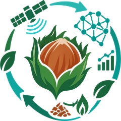
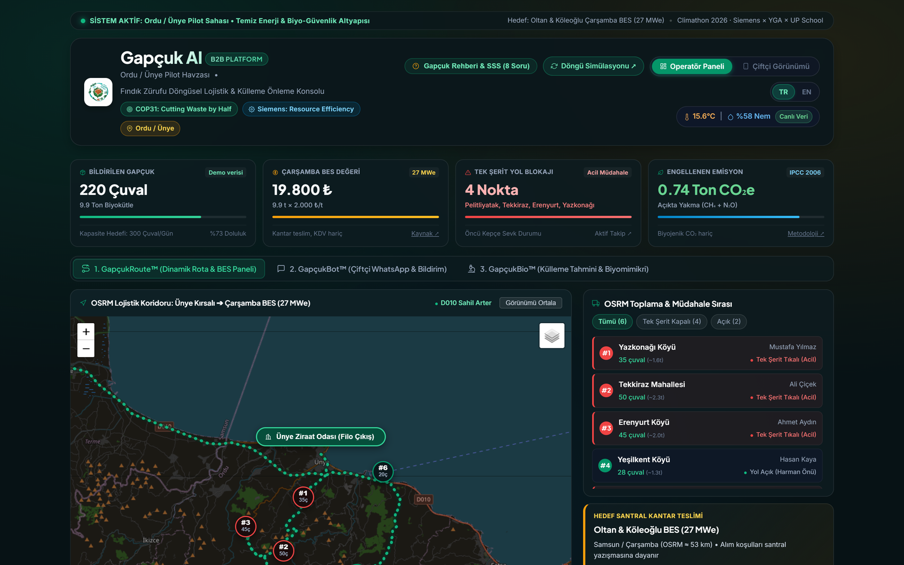
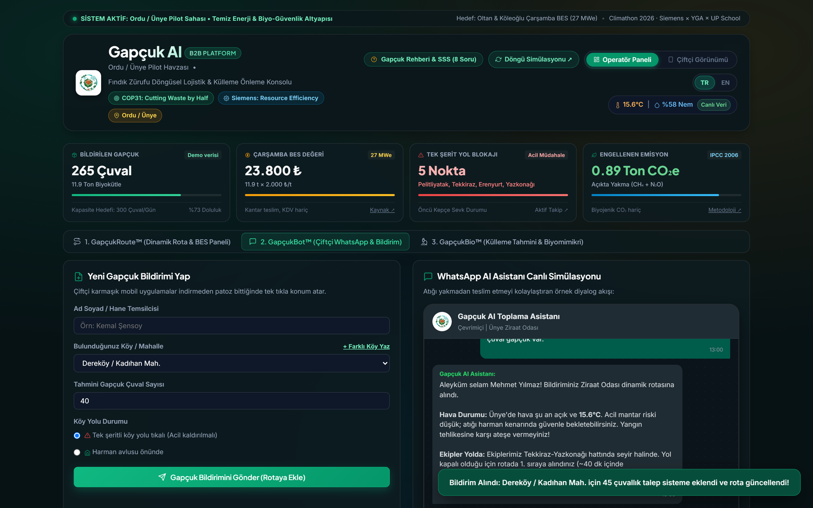
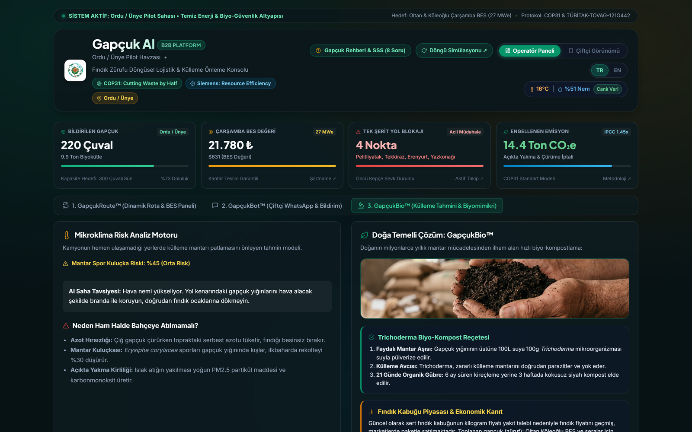

# Gapçuk AI




[](https://blosny.github.io/climathon-gapcuk-ai/)

Fındık zürufunu (yöresel adıyla **gapçuk**) yakılan bir atıktan temiz enerjiye ve komposta dönüştüren döngüsel bir lojistik platformu. **Siemens, YGA ve UP School Climathon 2026** programında Ordu / Ünye pilot bölgesi için geliştirildi.

**Stack:** HTML · CSS · Vanilla JavaScript · Leaflet · OpenStreetMap · OSRM · Open-Meteo · React 18 · GitHub Pages

**Canlı demo:** [blosny.github.io/climathon-gapcuk-ai](https://blosny.github.io/climathon-gapcuk-ai/) · **Simülasyon:** [Döngüyü başlat](https://blosny.github.io/climathon-gapcuk-ai/simulasyon.html)



---

## Modüller

| Modül | Ne yapar | Durum |
|---|---|---|
| GapçukRoute | Çiftçi bildirimlerinden durak sırası ve gerçek yol rotası çıkarır | Çalışıyor |
| GapçukBot | WhatsApp üzerinden bildirim alır, hava durumuna göre yanıt verir | Kural tabanlı |
| GapçukBio | Külleme riskini hesaplar, atığı santrale ya da komposta yönlendirir | Çalışıyor |
| Döngü simülasyonu | Atığın harmandan santrale ve toprağa dönüşünü canlandırır | Çalışıyor |

## Problem

- Patoz çoğu zaman tek şeritli köy yollarında yapılır; çıkan zürufun düzenli bir toplama mekanizması yoktur.
- Çiftçi yolu açmak için atığı ya **yakar** ya da bahçeye **çiğ serer**. Yakma hava kirliliğine, çiğ serme külleme mantarının (*Erysiphe corylacea*) bahçede kışlamasına yol açar.
- Bu biyokütlenin bölgede hazır alıcıları var (biyokütle santralleri, pelet üreticileri). Eksik olan, küçük üreticiyle alıcıyı buluşturacak lojistik.

## GapçukRoute: Rota Motoru

- Her bildirim haritada numaralı bir durak olur. Sıralama en yakın komşu yöntemiyle yapılır ve **yolu kapalı** köyler öne alınır (`optimizeStopSequence`).
- Rota kuş uçuşu değil, **OSRM** `route/v1/driving` ile gerçek köy yolu geometrisi üzerinden çizilir.
- OSRM yanıt vermezse sıralı noktalarla yedek bir rota çizilir.

## GapçukBot: Çiftçi Asistanı

- Çiftçi uygulama indirmeden konumunu, çuval sayısını ve yol durumunu tek mesajla bildirir.
- Yanıt, **Open-Meteo**'dan gelen anlık sıcaklık ve nem verisine göre değişir: nem yüksekse atığı örtme ve yakmama uyarısı, yol kapalıysa öncelikli toplama bilgisi.
- Şu an yanıtlar kural tabanlı; bir dil modeline taşınması yol haritasında.

## GapçukBio: Erken Uyarı ve Kompost

- Sıcaklık ve nemden külleme mantarı için bir risk skoru hesaplanır (`calculateMildewRisk`).
- Nem sınırının altındaki atık **biyokütle santraline**, üstündeki atık **Trichoderma** ile kompostlama hattına gider.
- Araç köye bir önceki partinin kompostunu götürür, dönüşte gapçuk yükler: boş dönüş olmaz.

## Döngü Simülasyonu

- [`src/simulasyon.html`](src/simulasyon.html): harman ve patoz, dağ lojistiği, enerji santrali ve biyo-kompost aşamalarını anlatan interaktif simülasyon.
- React 18 ve lucide-react ile tek dosya; build adımı yok. Değerler tek bir köy rotası için örnektir.

## İş Modeli

- Gelir, toplanan biyokütlenin santrale satışından gelir. Pilot bölgeye en yakın alıcı Samsun Çarşamba'daki biyokütle enerji santralidir.
- Santral kantar teslim alır: ton başına **2.200 TL**, azami nem **%35**<sup>[1]</sup>.
- Çiftçiye ücretsiz kompost geri döner. Birim ekonomi saha pilotunda gerçek maliyetlerle doğrulanacak.

## Ekran Görüntüleri





## Yol Haritası

- Bot yanıtlarını bir dil modeline taşımak, WhatsApp Business API ile gerçek mesajlaşma
- Ünye'de üreticiler, ziraat odası ve santralle saha görüşmeleri
- Rota tasarrufunu saha verisiyle ölçmek
- Sistemi fındık dışındaki tarımsal atıklara uyarlamak

## Yerel Çalıştırma

```bash
git clone https://github.com/blosny/climathon-gapcuk-ai.git
cd climathon-gapcuk-ai
python -m http.server 3000 --directory src
```

Ana platform `http://localhost:3000`, simülasyon `http://localhost:3000/simulasyon.html` adresinde açılır. Yedek yayın: [climathon-gapcuk-ai.vercel.app](https://climathon-gapcuk-ai.vercel.app) (vercel.app bazı Türkiye internet sağlayıcılarında açılmıyor).

## Kaynaklar

1. Oltan & Köleoğlu Çarşamba Biyokütle Enerji Santrali, biyokütle satın alma şartnamesi.
2. [OpenStreetMap](https://www.openstreetmap.org/copyright) · [OSRM](https://project-osrm.org/) · [Open-Meteo](https://open-meteo.com/)

---

Taha Buğra Çiçek · Ünye, Ordu
