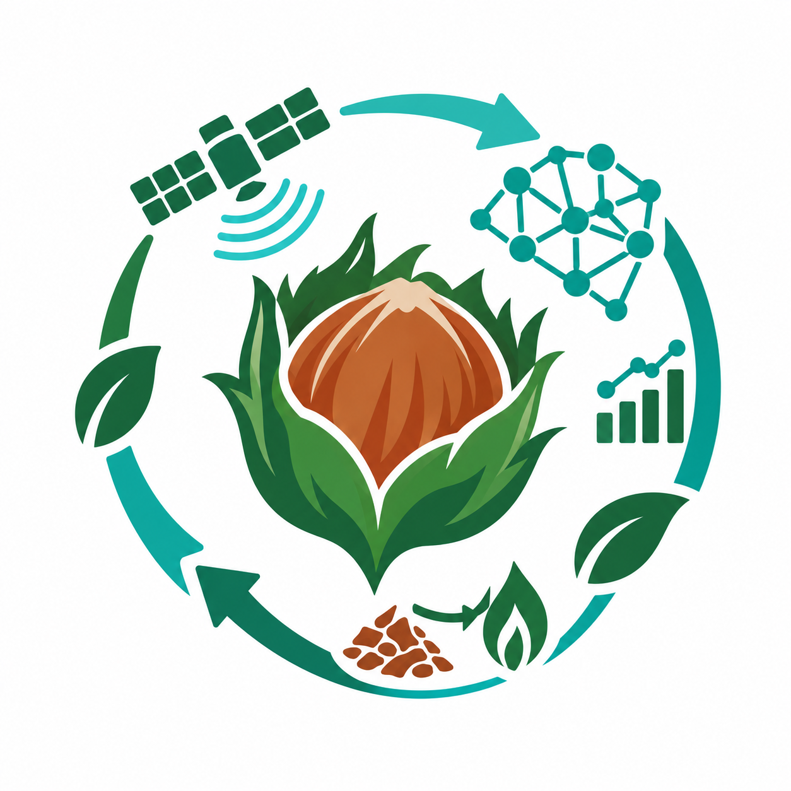

# Gapçuk AI

<p align="center">
  
</p>

<p align="center">
  Fındık zürufunu (yöresel adıyla <i>gapçuk</i>) yakılan bir atıktan temiz enerjiye ve komposta dönüştüren döngüsel lojistik platformu.<br>
  Ordu / Ünye pilot bölgesi · Siemens, YGA ve UP School Climathon 2026
</p>

<p align="center">
  <a href="https://blosny.github.io/climathon-gapcuk-ai/"><b>Canlı demo</b></a> ·
  <a href="https://blosny.github.io/climathon-gapcuk-ai/simulasyon.html"><b>Döngü simülasyonu</b></a>
</p>

<p align="center"><sub>Yedek adres: <a href="https://climathon-gapcuk-ai.vercel.app">climathon-gapcuk-ai.vercel.app</a> (vercel.app bazı Türkiye internet sağlayıcılarında açılmıyor)</sub></p>

---

## Problem

Fındık hasadında patozdan çıkan zürufun düzenli bir toplama mekanizması yok. Patoz çoğu zaman tek şeritli köy yollarında yapıldığı için atık yolu tıkıyor ve çiftçi yolu açmak için atığı ya yakıyor ya da bahçeye çiğ seriyor. Yakma hava kirliliğine, çiğ serme ise külleme mantarının (*Erysiphe corylacea*) bahçede kışlamasına yol açıyor.

Ünye'deki üreticilerle yaptığım görüşmelerde iki şey öne çıktı:

- Toplayacak biri olsa üreticilerin büyük çoğunluğu atığı vermeye hazır.
- Bu biyokütlenin bölgede hazır bir alıcısı var: biyokütle enerji santralleri ve pelet üreticileri.

Eksik olan, küçük üreticiyle alıcıyı buluşturacak lojistik ve koordinasyon. Gapçuk AI bu boşluğu kapatmayı hedefliyor.

## Çözüm

Platform birbirini besleyen üç modülden oluşuyor:

| Modül | Ne yapar |
|---|---|
| **GapçukRoute** | Çiftçi bildirimlerini haritada numaralı duraklara çevirir. Yolu kapalı köyleri öne alan bir sıralama yapar ve rotayı OSRM ile gerçek köy yolu geometrisi üzerinden çizer. |
| **GapçukBot** | Çiftçi, uygulama indirmeden WhatsApp akışıyla konumunu ve çuval sayısını bildirir. Yanıtlar anlık sıcaklık ve nem verisine göre şekillenir. |
| **GapçukBio** | Sıcaklık ve nemden külleme mantarı için bir risk skoru hesaplar. Kuru atığı santrale, ıslak atığı Trichoderma ile kompostlama hattına yönlendirir. |

Toplama aracı köye giderken bir önceki partinin kompostunu götürür, dönüşte taze gapçuğu yükler. Böylece araç boş dönmez ve çiftçiye somut bir fayda geri döner.

## Döngü simülasyonu

[`src/simulasyon.html`](src/simulasyon.html), atığın harmandan santrale, oradan tekrar toprağa dönüşünü dört aşamada anlatan interaktif bir simülasyon: harman ve patoz, dağ lojistiği, enerji santrali, biyo-kompost. Simülasyondaki değerler tek bir köy rotası için hazırlanmış örnek değerlerdir.

**[Simülasyonu tarayıcıda aç](https://blosny.github.io/climathon-gapcuk-ai/simulasyon.html)**

## Ekran görüntüleri

**GapçukRoute:** Rota ve filo paneli


**GapçukBot:** Çiftçi bildirimi ve WhatsApp asistanı


**GapçukBio:** Külleme riski ve kompost paneli


## İş modeli

Gelir, toplanan biyokütlenin santrale satışından gelir. Pilot bölgeye en yakın alıcı Samsun Çarşamba'daki biyokütle enerji santrali. Santral alımı kantar teslim yapıyor, yani nakliye satıcıya ait. Santralin satın alma şartnamesine göre ton başına alım fiyatı 2.200 TL, kabul edilen azami nem oranı %35<sup>[1]</sup>. Nem sınırını aşan atık kompostlama hattına gider ve çiftçiye ücretsiz kompost olarak geri döner.

Bu birim ekonomi, saha pilotunda gerçek maliyetlerle doğrulanacak.

## Teknoloji

- **Arayüz:** HTML, CSS ve Vanilla JavaScript (ES modülleri). Build adımı yok.
- **Harita ve rota:** Leaflet, OpenStreetMap, Esri World Imagery, OSRM
- **Hava verisi:** Open-Meteo
- **Simülasyon:** React 18 ve lucide-react, tek dosya
- **Yayın:** GitHub Pages (GitHub Actions ile), Vercel

## Durum ve yol haritası

Çalışan kısımlar:
- OSRM ile gerçek yol rotası ve filo telemetrisi
- Open-Meteo ile canlı hava verisi ve külleme risk skoru
- Çiftçi bildirim formu ve WhatsApp akışı simülasyonu
- İnteraktif döngü simülasyonu

Sıradaki adımlar:
- Bot yanıtlarını kural tabanlı akıştan bir dil modeline taşımak
- WhatsApp Business API ile gerçek mesajlaşma
- Ünye'de üreticiler, ziraat odası ve santralle saha görüşmeleri
- Rota tasarrufunu saha verisiyle ölçmek
- Sistemi fındık dışındaki tarımsal atıklara uyarlamak

## Yerel ortamda çalıştırma

Paket kurulumu gerekmez:

```bash
git clone https://github.com/blosny/climathon-gapcuk-ai.git
cd climathon-gapcuk-ai
python -m http.server 3000 --directory src
```

Ana platform `http://localhost:3000`, simülasyon `http://localhost:3000/simulasyon.html` adresinde açılır.

## Kaynaklar

1. Oltan & Köleoğlu Çarşamba Biyokütle Enerji Santrali, biyokütle satın alma şartnamesi (alım fiyatı ve nem kabul sınırı).
2. Harita ve rota verisi: [OpenStreetMap](https://www.openstreetmap.org/copyright), [OSRM](https://project-osrm.org/). Hava verisi: [Open-Meteo](https://open-meteo.com/).

---

**Geliştirici:** Taha Buğra Çiçek · Ünye, Ordu
Siemens, YGA ve UP School Climathon 2026 kapsamında geliştirildi.
